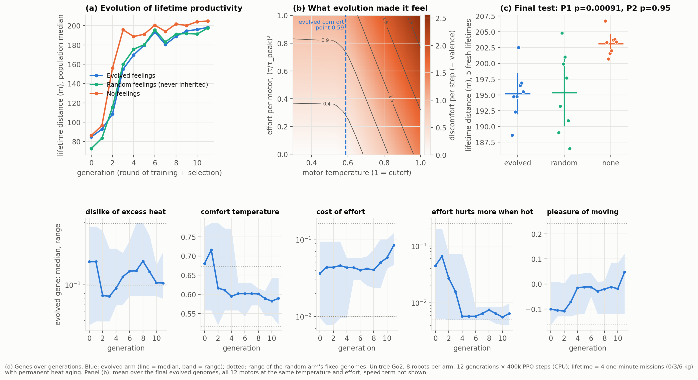
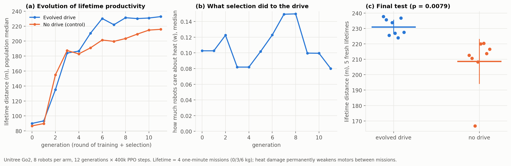
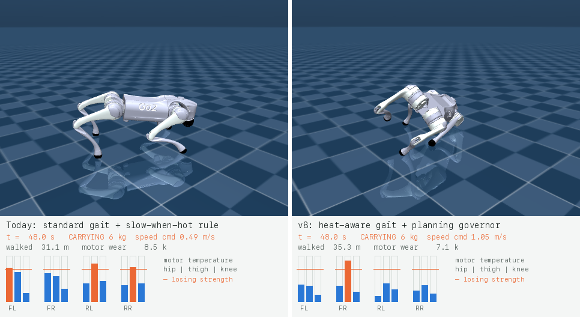
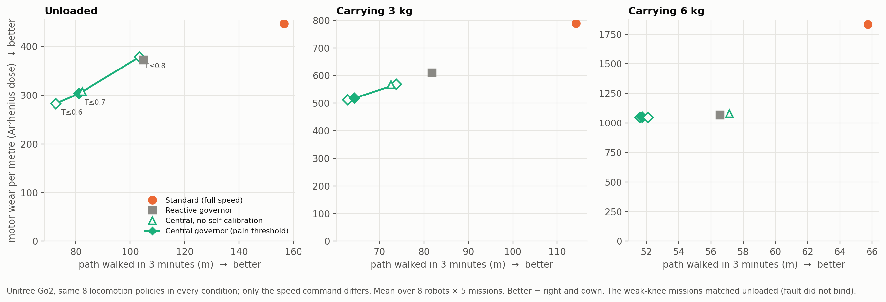
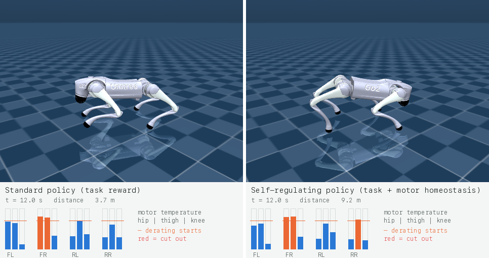
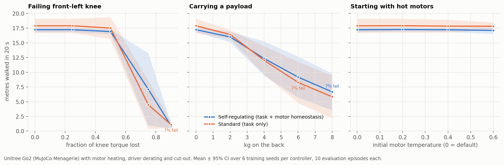
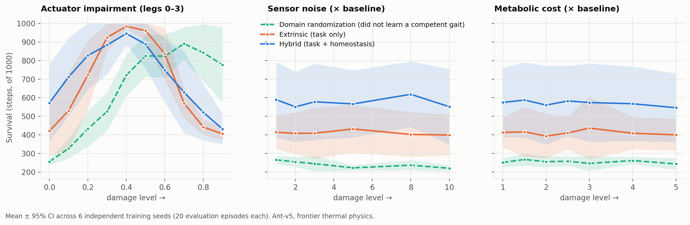
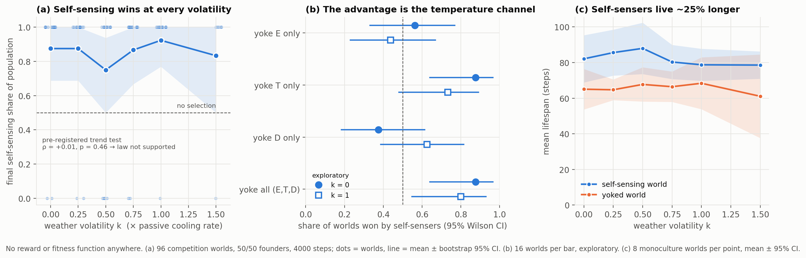

# Homeostatic Autonomy

[](https://github.com/pablopedrosap/homeostatic-Alife/actions/workflows/tests.yml)
[](LICENSE)


**Robots that look after their own bodies, tested with pass criteria written down before the
data existed.**

A robot that only chases its task can run itself into the ground: motors overheat, a weak leg
gets overloaded, and it falls. Animals work differently. Much of what a body does is keeping
itself working. This project builds controllers that **feel their own body** (motor
temperatures, energy, damage) and **act to protect it**, then checks whether that makes them
keep working when something breaks.

**[▶ Live page](https://pablopedrosap.github.io/homeostatic-Alife/site/)**: robot video,
interactive results, and an evolution simulation running in your browser.

> **Status, November 2026.** A testbed for robots that regulate their own bodies (a Unitree Go2
> whose motors heat up, derate and cut out; a MuJoCo Ant; a reward-free evolutionary world) and eight
> pre-registered experiments. **First pre-registered PASS (HAB-P9):** when *evolution* chooses how much
> each robot cares about its own motor heat, the robots are **11% more productive over a lifetime**
> (p = 0.008; every evolved robot beat every control robot) and never fell. The predicted mechanism,
> better body preservation, was **not** supported, and why the drive helps is the next question. Also
> holding up: robots that learn their own thermal physics to within 1.5%, 26–33% less motor wear per
> metre (at some cost in distance), and, from evolution in silico, a strong selection for sensing
> one's **own temperature** (p = 4×10⁻¹¹). **Latest (HAB-P10, FAIL):** with a richer evolved "feelings"
> genome the pattern flipped: bodies were preserved far better (−36% wear) but robots walked 4% less, and
> evolved feelings did no better than random ones. Over a 4-minute life, maintenance doesn't pay yet;
> the next test is whether it does over longer lives (Kirkwood's *disposable soma*).

---

## Results

### 1 · Unitree Go2 that manages its own motor heat (HAB-P10, P9, P8, P7, P2, P1)



**HAB-P10 ("v10"): verdict FAIL** ([pre-registration](docs/prereg/HABP10_evolved_feelings.md)). Each robot's
"feelings" about its body are a 5-gene genome: dislike of motor heat and from what temperature, cost of
effort, extra cost of effort when hot, pleasure of moving. Three groups of 8 with identical training
and selection: feelings **inherited and mutated**, feelings **random and never inherited** (variety
without evolution), and **no feelings**. Result: no feelings walked furthest (**203 vs 195 m, −4% for
evolved, p = 0.0005**), evolved = random (p = 0.95), but the robots with feelings ended their lives with
**36% less motor wear** (strength left 0.88 vs 0.82). The no-feelings robots were already faster in the
first mission, and no group lost distance across its 4 missions, so in a life this short the damage
never costs anything: biology's *disposable soma* trade-off. Report:
[`docs/results/HABP10_results.md`](docs/results/HABP10_results.md). A GPU replication with several times more
training per robot is pre-registered ([HAB-P10G](docs/prereg/HABP10G_gpu_replication.md)) and ready to run
on Kaggle ([`kaggle/habp10_gpu.ipynb`](kaggle/habp10_gpu.ipynb)).

#### HAB-P9 ("v9"): evolution chooses the drive



**HAB-P9 ("v9"): verdict PASS** ([pre-registration](docs/prereg/HABP9_evolved_drives.md)). Two groups of 8
robots trained with population-based evolution under developmental variability (loads switching
mid-walk, a weak motor, hot starts), sensing temperature **and effort** with a short memory. In one
group, how much each robot cares about motor heat is **inherited and mutated**; in the other it is
zero. Fitness = distance over a lifetime of 4 missions in which heat damage **permanently** weakens the
motors. Result: **231 vs 209 m (+11%, p = 0.008)**, complete separation, zero falls; selection kept a
moderate drive. But body preservation was the same in both groups, so the drive helps for a reason we
haven't pinned down yet (better training signal vs. diversity of objectives). A first run was void
because of a seeding bug (documented). Report: [`docs/results/HABP9_results.md`](docs/results/HABP9_results.md).

#### HAB-P8 ("v8"): heat-aware gait + anticipatory pacing

[](docs/media/go2_v8_courier.mp4)
*Click to play (45 s, 4× speed): today's practice (left: standard gait + slow-when-hot rule) vs v8
(right: heat-aware gait + planning governor) on a courier route with three 6 kg carries. Episode fixed
in advance (robot 0, first episode). In it v8 **freezes** after ~50 s: 37 m vs 102 m. One episode
is an illustration, not the result. The averages are below.*

**HAB-P8 ("v8"): verdict FAIL** ([pre-registration](docs/prereg/HABP8_gait_and_pacing.md)). Combining the
heat-aware learned gait with anticipatory pacing cut **motor wear per metre by 26%** vs today's
practice (p = 0.026), but walked 92% as far (CI [0.68, 1.14]; needed ≥ 0.95). Planning ahead again
didn't beat the simple rule. Exploratory: all falls came from **one** of 8 heat-aware robots, and
it was the **only robot of 16 that fell during its own pre-mission self-test**. Report:
[`docs/results/HABP8_results.md`](docs/results/HABP8_results.md).

#### HAB-P7 ("v7"): nature-inspired control stack



**HAB-P7 ("v7"), a nature-inspired control stack. Verdict: FAIL** ([pre-registration](docs/prereg/HABP7_central_governor.md),
with predicted outcomes written before running). The layers mirror a nervous system: motor drivers
derate when hot (reflex) → the trained gait policy (pattern generator) → 1 °C-resolution motor
temperatures and torques (interoception) → a **body schema the robot learns from its own exploratory
walk** and re-calibrates online (it detects a payload by itself) → a **central governor** that
simulates its own body to the end of the mission and picks the fastest pace that stays under a pain
threshold (Noakes' central governor; teleoanticipation).

| | Result |
|---|---|
| Did the robots learn their own physics? | yes: heating gain and cooling time constant within 1.5% for all 8 robots |
| Motor wear per metre vs full speed (primary) | **−33%**, p = 0.0003 ✓ |
| Distance vs full speed (competence guard ≥ 85%) | 0.78 [0.33, 1.24] ✗ |
| vs simple reactive governor | same trade-off curve: no better at matched distance |
| Knowing its *current* body (online self-calibration) | helps under load (p = 0.049) ✓ |

**Why:** at 0.4 m/s the hottest motor still gets 55% of the heat it gets at 1.0 m/s. Most heat
comes from bearing weight, so slowing down is a weak lever, and in steady missions "planning ahead"
reduces to "pick a slower pace". The one Pareto gain in the project came from the **learned gait**
(HAB-P2: 13% less heat at almost the same speed). Report: [`docs/results/HABP7_results.md`](docs/results/HABP7_results.md).

#### Earlier: HAB-P2 (end-to-end RL with a heat cost, 3-minute missions)

**HAB-P2 verdict: FAIL, as a valid test** ([pre-registration](docs/prereg/HABP2_go2_missions.md),
pushed before any mission ran). 3-minute missions at 1 m/s carrying 0/3/6 kg; 8 robots each of
standard, self-regulating (per-step motor-heat cost) and self-regulating + **self-model loop** (an
online-learned model of its own motor temperatures 2 s ahead, fed back into the policy); plus a
rule-based thermal governor (industry baseline) and a cut-the-loop ablation.

| | Result |
|---|---|
| Treatment gate: does the self-regulating robot actually run cooler? | **yes**: 0.749 vs 0.828 (needed ≥ 0.05) |
| Loaded-mission distance vs standard (primary) | 31.9 vs 37.6 m, p = 0.64: **not better** |
| vs rule-based governor · self-model vs none · loop intact vs cut | p = 0.99 · 0.70 · 0.21: no differences |

What actually happened (exploratory, post-hoc): every controller drifts off heading over 3 minutes,
so net displacement is a poor metric. Measured as path walked: **unloaded, the self-regulating robot
walks just as far (156 vs 156 m) with its hottest motor 0.08 cooler**. **Under load it freezes** in
10 of 40 missions instead of pacing itself, because a policy trained on 20-second episodes can't plan
over minutes. The **self-model is learned but unused**: cutting it out changes nothing. The next design
follows directly: mission-length training, the self-model inside the decision, and a freeze gate.
Full report: [`docs/results/HABP2_go2_results.md`](docs/results/HABP2_go2_results.md).

#### Earlier: HAB-P1 (20-second episodes)

[](docs/media/go2_fault_side_by_side.mp4)
*Click to play: standard (left) vs self-regulating (right), 75% knee-torque loss, live motor temperatures. One episode, fixed in advance. See the caveat below.*



The official Unitree Go2 model (DeepMind's MuJoCo Menagerie, Unitree's torque limits). Each of
its 12 motors heats with the square of its torque. Above 70% of the thermal limit the driver
cuts the available torque, and at 100% the motor cuts out, as on real hardware. The robot
reads its motor temperatures, which the real Go2 also reports. A standard controller (rewarded
for walking) and a self-regulating one (also rewarded for keeping its motors cool) were each
trained 6 times, then tested with a failing knee motor, payloads up to 8 kg, and hot motors.

**Verdict: FAIL** ([pre-registration](docs/prereg/HABP1_go2.md), pushed before any
self-regulating robot was trained). Metres walked under damage: knee fault +0.4 m (p = 0.68),
payload +0.5 m (p = 0.75), hot start −0.7 m (p = 0.16). No baseline cost, and falls are rare
for both.

**Why:** the self-regulation term ended up being only ~1.5% of the reward, so both controllers
learned the same way of using their motors. No motor ever reached cut-out, so damage hurt the
robot mechanically, not thermally, and there was nothing for self-regulation to prevent. The
next version needs a treatment-strength check before training and damage that can cause
thermal failure. The video above is the episode fixed in advance (75% knee fault). The gap in it
(14.6 m vs 1.6 m) is one episode with the same motor temperatures on both sides, not evidence of
an effect. Full report: [`docs/results/HABP1_go2_results.md`](docs/results/HABP1_go2_results.md).

### 2 · HAB-1 v1: does self-regulation buy robustness to damage? (MuJoCo Ant)



**Verdict: FAIL** (pre-registered: [`docs/prereg/HAB1_v1_ant.md`](docs/prereg/HAB1_v1_ant.md),
pushed while the models were still training). 6 seeds × {hybrid, extrinsic} × 2.4M PPO steps,
speed→heat physics, 20 episodes per damage level.

| | Result |
|---|---|
| Survival under damage, hybrid vs extrinsic (primary, Holm-corrected) | sensor noise +169 steps (g = 1.07, p_holm = 0.23); metabolic cost +156 (g = 0.96, p_holm = 0.23); actuator +13 (p = 0.74) → **no sweep significant** |
| Baseline tax? | none: hybrid walks as far undamaged (26.2 vs 22.4 m) |
| Does heat actually bite? | yes: undamaged peak temperature 0.95 against a 0.7 danger threshold |
| Direction | hybrid ahead at 16 of 20 damaged levels (sign test p = 0.012, secondary) |

**Why it failed, and what it taught:** the thermal physics turned out to be the main killer
even *without* damage. Undamaged, standard agents finish only 2% of episodes, dying of damage
built up while running hot; hybrid agents finish 20%. Under sensor and metabolic damage the
hybrid's lead is just that same baseline offset, and moderate leg damage *helps* both agents
because it slows them down and cools them. The effect points the right way (g ≈ 1), but 6 seeds
can't separate it from noise. A powered replication needs ~16–21 seeds per condition, and the
thermal calibration should leave a competent undamaged baseline. Full report:
[`docs/results/HAB1_v1_results.md`](docs/results/HAB1_v1_results.md).

### 3 · Side experiment, HAB-E2v: does evolution build self-sensing on its own?



A population of neural organisms with **no reward and no fitness function**. Genomes are
inherited birth weights, controllers rewire with a local Hebbian rule, organisms die when
they overheat, starve or take too much damage, and they split when they have gathered
enough energy. Half the founders feel their own body. The other half are **yoked**: they
feel a random partner's body, which is the same kind of signal with no information about
themselves.

| | Result |
|---|---|
| Pre-registered hypothesis: climate volatility increases selection for self-sensing | **Not supported** (ρ = +0.01, p = 0.46). Same in the K-selection regime. |
| Does selection favour self-sensing at all? | **Yes, strongly:** self-sensers took over **70 of 82** worlds (p = 4×10⁻¹¹), including a perfectly constant climate (p = 0.003). |
| Lifespan, self-sensing vs yoked (exploratory) | **+25%** (82 vs 66 steps, p = 5×10⁻⁷) |
| Which signal carries it? (exploratory) | **Temperature alone.** Yoking only T reproduces the full effect; energy and damage don't. |
| Is it thermoregulation? | **No signature found.** Self-sensers' temperature tracks the weather as much as the yoked organisms', and there is no "slow when hot" reflex. The mechanism is open. |

This result **retracts** this repo's July 2026 conclusion that "selection does not build
self-regulation". That analysis compared populations in separate worlds and blinded them by
zeroing inputs. Both are confounds, and with a fair control the sign flips. Full report:
[`docs/results/HAB_E2v_results.md`](docs/results/HAB_E2v_results.md).

---

## Where this is going

Nobody can measure whether a machine has experiences, so this project makes no such claim.
What can be built and tested are the working parts people usually mean by a robot that is
aware of itself:

| Step | Capability | Status |
|---|---|---|
| 1 | **Feels its own body**: motor temperatures, energy and damage as inputs | built (simulation) |
| 2 | **Acts to keep its body working**, and that pays off when something breaks | partly: −33% motor wear per metre (HAB-P7), at a cost in distance |
| 3 | **Knows what it can do right now** ("my left knee is weak") and changes its plan | yes, in a limited form: learns its own thermal physics and detects a payload online (HAB-P7) |
| 4 | **Does all of this on a real robot**: one quadruped that keeps walking with a failing motor | goal |

## How the work is done

- **Pre-registration.** Each experiment has a file in [`docs/prereg/`](docs/prereg) fixing
  physics, seeds, statistical test and pass threshold *before* the first run. Analyses that
  were added later are labelled exploratory everywhere they appear.
- **All seeds reported.** No seed selection, no best-of-N.
- **Corrections in the open.** When an earlier analysis turns out to be confounded it is
  retracted in the docs, not silently replaced (see the research log below).
- **Anti-metrics.** Every robustness claim is checked against a baseline tax, a handicapped
  foil, and "survival by doing nothing" ([`docs/BENCHMARK.md`](docs/BENCHMARK.md)).
- **No consciousness claims.** The long-term direction is described in
  [`docs/THESIS.md`](docs/THESIS.md). It deliberately stops at capacities that can be
  measured.

## The system

Every agent carries three internal variables that must stay in a viable range:

| Variable | Update rule | Death |
|---|---|---|
| Energy `E` | `E -= basal + move_cost·‖a‖ − nutrient` | `E ≤ 0` |
| Temperature `T` | `T += heat_move·‖a‖² + heat_sources + speed_heat·v − cooling` | `T ≥ T_fatal` |
| Damage `D` | `D += toxin + overheat·relu(T − T_crit) − repair·rest` | `D ≥ D_max` |

High temperature and damage also inject noise into the agent's observations ("brain fog"),
so stress degrades perception as well as reward.

| Reward mode | Formula |
|---|---|
| `extrinsic` | `r = r_task` (Ant-v5 forward progress) |
| `homeostatic` | `r = Δ(deviation from setpoints) − alive_cost` |
| **`hybrid`** | `r = r_task + 0.3 · r_homeostatic` |
| `survival` | `r = +1 per step alive` (no setpoints, used for the emergence experiments) |

In the frontier thermal configuration used by HAB-1 v1, running fast generates heat
(`forward_vel_heat_gain = 0.10`, calibrated once against the extrinsic foil with
[`scripts/probe_thermal.py`](scripts/probe_thermal.py) and then frozen), so "run as fast as
possible" and "stay alive" genuinely conflict.

## Reproduce

```bash
git clone https://github.com/pablopedrosap/homeostatic-Alife.git && cd homeostatic-Alife
python3 -m venv .venv && source .venv/bin/activate
pip install -e ".[dev]"
python scripts/fetch_go2.py                     # Unitree Go2 model (MuJoCo Menagerie, pinned)
python -m pytest tests/ -q                      # ~15 s

# HAB-P7: development walks + 960 missions with the HAB-P2 gait policies (~10 min on 8 cores)
python scripts/run_go2_v7.py && python scripts/analyze_go2_v7.py

# HAB-P2: 24 Go2 agents × 5M steps + 3-minute missions (~2.5 h on 8 cores)
python scripts/run_go2_v2.py --workers 8 && python scripts/analyze_go2_v2.py

# HAB-P1: 12 Go2 agents × 4M PPO steps + damage evaluation (~1.5 h on an 8-core laptop)
python scripts/run_go2.py --workers 6
python scripts/analyze_go2.py                   # pre-registered verdict
python scripts/record_go2.py                    # side-by-side video (scenario fixed in advance)

# HAB-1 v1: 18 PPO agents × 2.4M steps + 1,380 evaluation conditions.
# ~1.7 h on an 8-core laptop (one torch thread per worker).
python scripts/run_hab1_v1.py --workers 6
python scripts/analyze_hab1_v1.py               # pre-registered verdict

# HAB-E2v: 240 evolutionary worlds (~17 min on 2 cores) + exploratory dissection (~4 min)
python scripts/run_regulator_law.py
python scripts/run_channel_dissection.py

python scripts/make_figures.py --hab1 results/hab1_v1/csv/progressive_damage.csv --regulator results/regulator_law
python scripts/build_site.py                    # rebuilds the live demo page
```

## Repository map

```
homeostatic_colony/
  dynamics/homeostasis.py        E/T/D update rules and viability
  dynamics/batched_homeostasis*  vectorised E/T/D (numpy / torch) for many parallel envs
  envs/ant_homeostatic.py        MuJoCo Ant-v5 + internal state, reward modes, damage knobs
  envs/go2_homeostatic.py        Unitree Go2 with motor thermals, driver derating, faults, payload, governor
  envs/self_model.py             online-learned model of the robot's own motor temperatures (the loop)
  control/central_governor.py    body schema learned from own experience + teleoanticipatory pacing
  control/anticipatory.py        governor that knows the mission plan and pre-cools (v8)
  envs/humanoid_homeostatic.py   Humanoid-v5 wrapper (experiment not yet run)
  alife/emergent_world.py        reward-free evolutionary world (weather, yoked control, probes)
scripts/
  run_go2_v9.py, analyze_go2_v9.py   HAB-P9 population-based evolution of drives, lifetime with aging
  run_go2_v10.py, analyze_go2_v10.py HAB-P10 evolved 5-gene feelings vs random vs none (also reads GPU runs)
  run_go2_v8.py, analyze_go2_v8.py   HAB-P8 gait × pacing on changing-demand missions
  record_go2_v8.py               v8 courier video (live temperatures, load, wear)
  run_go2_v7.py, analyze_go2_v7.py   HAB-P7 nature-inspired stack (development walk + missions)
  run_go2_v2.py, analyze_go2_v2.py   HAB-P2 missions, self-model loop, governor; pre-registered analysis
  explore_go2_v2.py              exploratory mission diagnostics (path walked, freezing)
  run_go2.py, analyze_go2.py     HAB-P1 training/evaluation and pre-registered analysis
  record_go2.py                  side-by-side robot video with live motor temperatures
  run_hab1_v1.py                 parallel, resumable HAB-1 runner
  analyze_hab1_v1.py             pre-registered HAB-1 analysis
  run_regulator_law.py           HAB-E2v protocol + analysis
  run_channel_dissection.py      exploratory follow-up
  make_figures.py, build_site.py figures and the live demo page
docs/
  prereg/                        pre-registrations (written before the runs)
  results/                       full result reports
  THESIS.md, BENCHMARK.md        research program and the benchmark ladder
  site/                          live demo (JS port of the evolutionary world)
kaggle/                          GPU edition (MJX + Brax PPO): notebook + step-by-step guide
tests/                           145 tests, incl. golden-value tests that pin the original world
```

The vectorised E/T/D module updates the internal state of 4,096 parallel bodies in about
50 µs on a laptop CPU (`scripts/benchmark_batched.py`, NumPy; a Torch version is verified
equal to 1e-5). That measures the homeostasis layer only, not physics simulation. The point
is that the layer adds negligible overhead on top of a GPU simulator such as Isaac Lab.

## Research log

| Date | What happened |
|---|---|
| 2026-03 | First 6-seed damage sweep. Hybrid looked far more robust (e.g. 82% vs 27% full episodes at 40% actuator damage), but the extrinsic foil also survived only **27% of episodes with no damage at all**. The gap was mostly a baseline difference, so the run is superseded. |
| 2026-07 | HAB-1 v0 (3 seeds): strong directional signal, but temperature never reached the danger band, and under a corrected analysis it is not significant (Holm p = 0.39). The thermal coupling was then calibrated. |
| 2026-07 | HAB-E2: "selection does not build self-regulation". **Retracted 2026-11** (confounded design). |
| 2026-11 | Three pre-registered experiments. HAB-1 v1: FAIL (right direction, underpowered, baseline dominated by heat). HAB-E2v: hypothesis failed, but self-sensing is strongly selected. HAB-P1 (Go2): FAIL (treatment too weak, no thermal failures). HAB-P2 (Go2 missions + self-model): FAIL as a valid test (free cooling unloaded, freezing under load, self-model unused). HAB-P7 (nature-inspired stack): FAIL on distance, −33% wear, robots learned their own physics. HAB-P8 (gait + anticipation): FAIL on distance, −26% wear; self-test flagged the one robot that couldn't carry loads. HAB-P9 (evolved drives): run 1 void (seeding bug), run 2 **PASS** (+11% lifetime productivity, p = 0.008). HAB-P10 (evolved 5-gene feelings + random-feelings control): **FAIL**, reversed (−4% distance, p = 0.0005; −36% wear), evolved = random. GPU population trainer (24 brains in one compiled program) and pre-registered GPU replication HAB-P10G. |

## Roadmap

1. **Go2 v10:** separate *why* the evolved drive helps: add an arm with random but fixed drives
   (diversity without inheritance), and replicate at GPU scale (`kaggle/`).
2. **HAB-1 v2 (Ant):** 16–21 seeds per condition, with physics that leave a healthy undamaged baseline.
3. **HAB-2: predictive self-maintenance.** Does a learned risk signal rise *before* failure?
4. **HAB-E2v follow-up:** find the mechanism by which self-temperature helps (efference-copy
   hypothesis vs context-dependent use vs plasticity).
5. **Hardware:** one commodity quadruped that keeps walking with a disabled motor.

## Citation

```bibtex
@software{pedrosa_homeostatic_autonomy_2026,
  title  = {Homeostatic Autonomy: pre-registered experiments on self-regulating agents},
  author = {Pedrosa, Pablo},
  year   = {2026},
  url    = {https://github.com/pablopedrosap/homeostatic-Alife}
}
```

MIT License.
