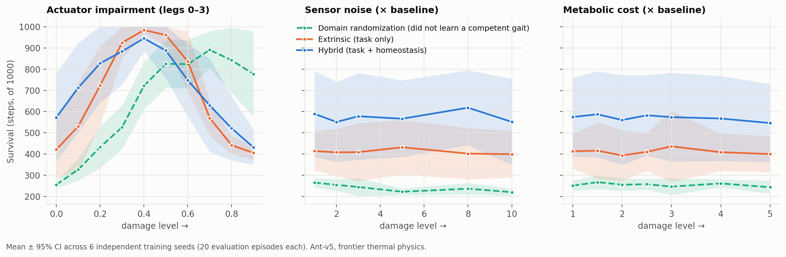

# HAB-1 v1 results — graceful degradation on MuJoCo Ant

*Run 2026-11-08 (147 min on an 8-core laptop). Pre-registration:
[`docs/prereg/HAB1_v1_ant.md`](../prereg/HAB1_v1_ant.md), pushed to GitHub while the models
were still training. Raw data: `results/hab1_v1/csv/progressive_damage.csv` (414 rows: 3
conditions × 6 seeds × 23 damage levels × 20 episodes). Verdict:
`python scripts/analyze_hab1_v1.py`.*

## Verdict: FAIL

No damage family shows a significant hybrid advantage after Holm correction, so the
pre-registered criterion is not met.

| P1: survival under damage (AUDC, steps of 1000) | hybrid | extrinsic | Δ [95% CI] | Hedges g | p | p (Holm) |
|---|---|---|---|---|---|---|
| actuator impairment | 752 | 739 | +13 [−50, +88] | +0.18 | 0.74 | 0.74 |
| sensor noise | 582 | 413 | +169 [+15, +313] | +1.07 | 0.077 | 0.23 |
| metabolic cost | 569 | 413 | +156 [+2, +305] | +0.96 | 0.11 | 0.23 |

| Check | Result |
|---|---|
| **P2** no free lunch (undamaged distance) | hybrid 26.2 m vs extrinsic 22.4 m, p = 0.51: no baseline tax ✓ |
| **M1** does heat bite the foil? | undamaged peak T = 0.95 (danger band starts at 0.7) ✓, unlike v0 |
| **S2** sign test over damaged levels | hybrid ahead at 16/20, p = 0.012 (secondary) |
| **S3** distance under damage | no significant difference in any sweep |
| **S1** legacy per-level analyzer | would have declared the sensor sweep a **PASS** (one significant level out of 6) |

## What actually happened

1. **The thermal physics dominate everything, including the undamaged baseline.** Undamaged,
   the extrinsic agents finish only **2%** of episodes and hybrid agents **20%**. Almost all
   deaths are `damage_overload`, i.e. damage accumulated while running above the critical
   temperature (spot check: extrinsic peak T 1.07, hybrid 0.92). The speed→heat coupling was
   calibrated in July so that heat would *bite*. It now bites so hard that the baseline is
   itself a damaged condition.
2. **Sensor noise and metabolic cost barely matter to either agent.** Both curves are flat. The
   hybrid's lead under those sweeps is the same constant offset it already has undamaged
   (573 vs 422 steps, p = 0.15). So even if it had been significant, it would have shown
   "survives better under harsh thermal physics", not "degrades more gracefully".
3. **Actuator damage paradoxically helps.** Moderate leg weakness raises extrinsic full-episode
   survival from 2% to 94% (δ = 0.4): weaker legs mean slower running, less heat and less
   damage. The actuator sweep therefore measures thermal throttling as much as damage
   tolerance.
4. **The domain-randomization reference failed to learn a competent gait** (5–10 m undamaged,
   against 15–43 m for the others). It is not a meaningful oracle, so the descriptive
   comparison D1 is uninformative and is not reported as a result.

## What this does and doesn't tell us

- The direction is consistent: hybrid is ahead at 16 of 20 damaged levels and on the baseline,
  with medium-to-large effect sizes (g ≈ 1) on two sweeps. But **6 seeds is not enough** to
  separate that from seed-to-seed variance under these physics. For g = 1, 80% power needs
  roughly 16–21 seeds per condition.
- The March 2026 headline ("82% vs 27% full episodes at 40% actuator damage") is **not
  supported**. In v1 at δ = 0.4 the full-episode rates are extrinsic 94%, hybrid 75%.
- The design lesson carries over to the Go2 experiment (HAB-P1): thermal constants must leave a
  competent undamaged baseline, so that damage, not the baseline, is what's being tested.

## Deviations from the pre-registration

- `welch()` in the analyzer gained a guard for the degenerate case where both groups have zero
  variance (it previously returned `nan`). No HAB-1 v1 comparison is degenerate, so no number
  changed.
- No other deviations. All seeds are reported.
