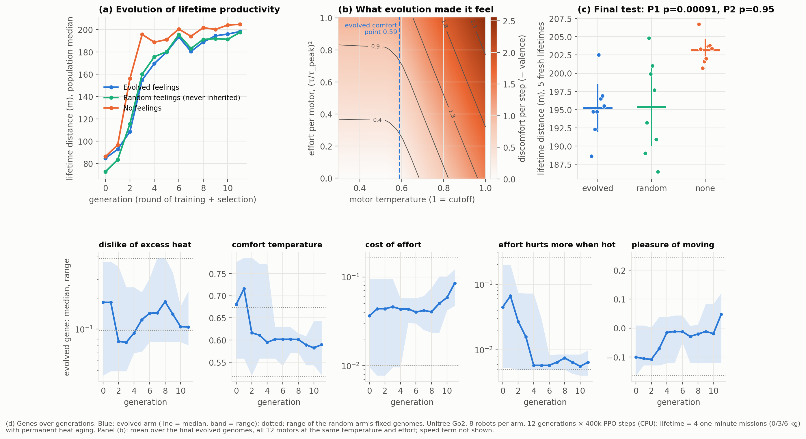

# HAB-P10 results: evolved feelings ("v10")

*Run 2026-11-09 (158 min on the laptop: 24 Go2 robots × 12 generations × 400k PPO steps, then 120 fresh
lifetimes). Pre-registration: [`docs/prereg/HABP10_evolved_feelings.md`](../prereg/HABP10_evolved_feelings.md).
The analyzer was committed before the data existed. Data: [`data/habp10_go2/`](../../data/habp10_go2/).
Verdict: `python scripts/analyze_go2_v10.py --dir data/habp10_go2`.*

## Verdict: FAIL, with a significant effect in the opposite direction

| Endpoint | Result |
|---|---|
| **P1** lifetime distance, evolved feelings vs none | **195.2 vs 203.2 m (−3.9%)**, Welch p = 0.00046 (Holm 0.0009). Significant, but **against** the feelings |
| **P2** evolved vs random feelings | 195.2 vs 195.4 m, p = 0.95: selection made no difference beyond having feelings |
| **S2** random vs none | 195.4 vs 203.2 m, p = 0.011 |
| **S3** body after a lifetime | motor wear **−36%** (evolved 52k, random 56k, none 81k); motor strength left **0.88 / 0.87 vs 0.82**. Falls: 0.03 / 0.05 / 0.00 per lifetime |
| **S1** what evolution did to the genes | "effort hurts more when hot" was driven to the floor (median ~0.05 → 0.006) within 4 generations; the comfort temperature dropped (0.68 → 0.59); cost of effort rose late (0.04 → 0.085); dislike of heat stayed moderate (~0.1); pleasure of moving drifted from negative to slightly positive |

The S3 differences are very large (exploratory Welch on wear and strength: p ≈ 10⁻⁹). P1 and P2 are
the only confirmatory tests.

## What it means

- **The HAB-P9 result did not replicate with richer feelings.** In HAB-P9 a single inherited heat drive
  made robots 11% more productive with no change in body preservation. Here, a 5-gene valence (heat,
  comfort point, effort, effort-when-hot, pleasure of moving) produced the **opposite pattern**:
  strongly preserved bodies and slightly lower productivity.
- **Selection of feelings did not beat random feelings** (P2). The evolved and random arms are
  indistinguishable on every measure. So the gene trajectories in panel (d) are, at most, weak
  evidence: with 8 robots and 2 copies per generation, genes that travel with successful *brains*
  can rise by hitchhiking or drift. No gene correlated with performance across the 16 robots with
  feelings (all |Spearman ρ| ≤ 0.34, p ≥ 0.19; exploratory).
- **Why preservation didn't pay (exploratory):**
  - The no-feelings robots were already ahead in the **first** mission, with an intact body
    (50.1 vs 48.3 m). The gap is a speed difference, not aging.
  - No arm walked less in its 4th mission than in its 1st, even though the no-feelings robots ended with
    18% less motor strength. Within a 4-minute life the damage is real but **does not yet cost any
    distance**: the gait has a strength margin.
  - Paying for maintenance (feelings slow the robot a little, and they slowed learning to walk:
    generation 2 medians 108–116 vs 156 m) brings nothing back if life ends before the damage bites.
- **Biology says the same thing.** Kirkwood's *disposable soma* theory: an organism should invest in
  body maintenance only in proportion to how long it can expect to live. With a short lifetime,
  selection favours spending on output now. This is a falsifiable prediction for the next experiment:
  **the value of body-protective feelings should grow with lifespan.** With 16 missions instead of 4, the
  no-feelings robots would be at ~0.43 motor strength and the feeling robots at ~0.58 (extrapolating
  the measured wear rates), well into the range where the gait should fail. Not tested here.

## Limits
8 robots per arm; one laptop; a single 4-mission lifetime per generation as fitness (noisy); thermal
and aging constants time-compressed and not identified on hardware. "Feelings" = a reward function,
a functional analogue of valence; no claim about experience.

## Deviations
None. The analyzer's figure caption was edited after it was committed (it now describes CPU or GPU runs);
the analysis code is unchanged.
