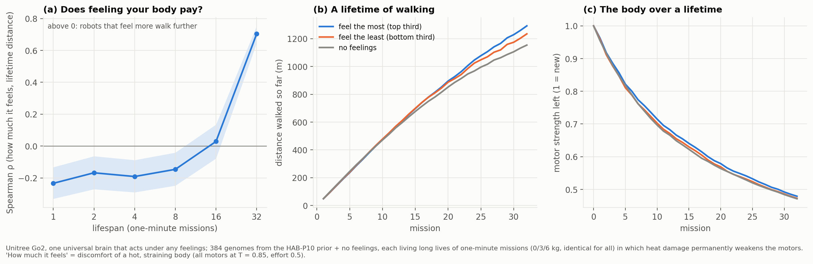

# HAB-P12R results: the ecology of feeling, independent replication

*Run 2026-11-11 (new universal brain 102 min, 24M steps; landscape 104 min, 776 lives of 32 one-minute
missions). Pre-registration: [`docs/prereg/HABP12R_replication.md`](../prereg/HABP12R_replication.md),
written after HAB-P12 was scored VOID and before any of this data. Data and the trained brain:
[`data/habp12r_go2/`](../../data/habp12r_go2/). Verdict:
`python scripts/analyze_go2_v12.py --dir data/habp12r_go2 --gate r2 --fig-name habp12r_ecology.png`.*

## Verdict: PASS

| Endpoint | Result |
|---|---|
| **Gate:** the 5 genes explain ≥ 30% of first-mission wear | **R² = 0.94** → valid. It also passes HAB-P12's original gate: ρ(π, wear) = −0.60 ≤ −0.3 |
| **P1:** ρ(π, F_32) − ρ(π, F_1) > 0 | **+0.94**, 95% CI [+0.82, +1.05], p < 10⁻⁴, significant |
| **P2:** ρ(π, F_32) > 0 | **+0.70**, p = 9×10⁻⁵⁹, significant |
| S1: ρ(π, F_L) by lifespan | −0.23, −0.17, −0.19, −0.15 for L = 1, 2, 4, 8 missions; +0.03 at 16; **+0.70 at 32** |
| S2: best decile (chosen on one life, scored on another) vs no feelings | +6% at L = 1, +2–4% at L = 2–8, +7.5% at 16, **+13.9% at 32** (1314 vs 1154 m) |
| S5: best decile's genes, 32 minus 1 mission | cost of effort **+0.072** [+0.031, +0.114]; effort-when-hot +0.032 [−0.003, +0.063], right direction but n.s.; pleasure of moving **−0.166** [−0.210, −0.109] |
| S4: body | ρ(π, strength left after 32 missions) = +0.25; no-feelings robots end at 0.47 |

**Predictions written in advance:**
- Gate 90%: ✓. P1 75%: ✓. P2 60%: ✓.
- Gene shift in the predicted direction for all three genes (60%): ✓ in direction, with effort-when-hot
  not significant.
- "The absolute effect stays small, a few %": **✗**. It was +13.9% at 32 missions, larger than predicted.

## What it means

- **When a robot should feel its body depends on how long it will live.** That was the hypothesis of
  HAB-P12, and it now holds on an independent brain, independent genomes and independent lives.
  - Over short lives (1–8 missions), robots that feel their bodies more walk less.
  - The sign flips between 16 and 32 missions.
  - Over a 32-minute life, the robots that feel the most walk furthest, and the best feelings beat
    no feelings by 14%.
  - This is the robot analogue of Kirkwood's *disposable soma*: maintenance pays only when there is
    enough life ahead.
- **What a good feeling is changes with lifespan.** For short lives, the best genomes enjoy moving and
  barely mind effort. For long lives, the pleasure of moving disappears and effort becomes costly.
  This fits *the optimal reward problem* (Singh, Lewis & Barto): an evolved reward should carry
  information the learner cannot see. Here that is the cost of today's effort to a body that has to
  last, which is invisible to a learner whose horizon is ~2 s.
- **The two runs agree on the shape but not on the size.** In HAB-P12 (a different brain), the same
  analysis gave ρ(π, F_32) = +0.22 and +5.5% for the best decile. The direction replicates; the
  effect size depends on the trained brain.

## How the advantage arises (exploratory)

| | distance per mission, missions 1–8 | missions 25–32 | strength after 16 / 32 missions | falls, missions 17–32 |
|---|---|---|---|---|
| feel the most (top third by π) | 47.6 m | **30.8 m** | 0.628 / 0.479 | 0.12 |
| feel the least (bottom third) | 48.2 m | 26.3 m | 0.618 / 0.473 | 0.17 |
| no feelings | 48.0 m | 23.3 m | 0.609 / 0.471 | 0.00 |

- Early in life everyone walks the same.
- In old age, the robots that feel the most walk **32% further per mission than robots without
  feelings, with nearly the same motor strength left**. So the main benefit is not a better-preserved
  body, but *living better with an aged one*: keeping a pace that weakened motors can sustain.
- This is a post-hoc reading. A test of it would need its own pre-registration.
- **Update:** [HAB-P13](HABP13_results.md) tested it. Late care matters most, but early care also pays
  later, so preservation is part of the story too.

## Limits

- Simulation only, with time-compressed thermal constants not identified on hardware.
- Two universal brains. The effect size varies between them.
- A fitness landscape, not an evolutionary run.
- Lifespans up to 32 one-minute missions.
- "Feelings" means a reward function; no claim about experience.

## Deviations

- **Gate redefined** relative to HAB-P12, disclosed in the pre-registration. Moot here: the run passes
  under both definitions.
- **Analyzer figure fix.** A variable in the analyzer's figure code overwrote the output file name, so
  the first rendering was saved under the wrong name. Fixed and re-rendered; the numbers are unaffected.
