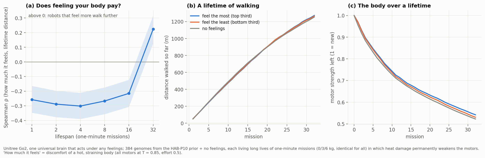

# HAB-P12 results: the ecology of feeling ("v12")

*Run 2026-11-09 (universal brain 49 min, 24M steps; landscape 57 min, 776 lives of 32 one-minute
missions). Pre-registration: [`docs/prereg/HABP12_ecology_of_feeling.md`](../prereg/HABP12_ecology_of_feeling.md).
The analyzer was committed with it, before any landscape data. Data and the trained brain:
[`data/habp12_go2/`](../../data/habp12_go2/). Verdict: `python scripts/analyze_go2_v12.py --dir data/habp12_go2`.*

## Verdict: VOID (the manipulation check failed narrowly)

The pre-registered gate required ρ(protectiveness, first-mission wear) ≤ −0.3 across the 384 genomes.
It came out **−0.22**. By the rules written in advance, the run is not scored, whatever the endpoints
say. Everything below is therefore **descriptive**, and an independent, pre-registered replication
([HAB-P12R](../prereg/HABP12R_replication.md)) decides.

| Endpoint (not scorable) | Result |
|---|---|
| P1: ρ(π, F_32) − ρ(π, F_1) | **+0.48**, CI [+0.35, +0.61] (predicted > 0) |
| P2: ρ(π, F_32) | **+0.22**, p = 9×10⁻⁶ (predicted > 0) |
| S1: ρ(π, F_L) by lifespan | −0.26, −0.29, −0.30, −0.27, −0.22 for L = 1–16 missions, then **+0.22 at L = 32** |
| S2: best decile (held out) vs no feelings | +9% at L = 1, +2–3% at L = 2–16, **+5.5% at L = 32** (1323 vs 1254 m; above all 8 no-feelings lives) |
| S3/S5: genes of the best decile, L = 32 minus L = 1 | cost of effort **+0.096** [+0.065, +0.123]; effort-when-hot **+0.094** [+0.051, +0.153]; pleasure of moving **−0.157** [−0.258, −0.061] |
| S4: body | ρ(π, strength left after 32 missions) = +0.34; no-feelings robots end at 0.52 strength |

## What it shows, descriptively

- **The predicted shape appeared.** Over short lives, feeling one's body costs distance (as in HAB-P10).
  Over the longest lives tested it pays. The crossover falls between 16 and 32 missions.
- **What makes a "good" feeling depends on lifespan.**
  - For short lives, the best genomes enjoy moving and barely mind effort.
  - For long lives, the best genomes mind effort, especially when hot, and the pleasure of moving
    disappears.
  - This is the disposable-soma prediction (invest in output when life is short, in maintenance when
    it is long), here as a shift in what an evolved valence should value.
- **The effect in metres is small.** The thirds of most and least protective genomes differ by about
  0.5% in lifetime distance and 0.01 in strength left (panels b and c). The best decile beats no
  feelings by 5.5% at 32 missions. The rank correlation is clear; the practical size is modest.

## Why the gate failed (exploratory)

- First-mission wear is dominated by the *pleasure of moving* gene (ρ = +0.80), which the
  protectiveness index π leaves out.
- Controlling for it, ρ(π, wear) = −0.31. The 5 genes together explain 58% of first-mission wear.
- So the brain does respond to its feelings. The check, as written, asked about π alone.
- These are post-hoc readings. They motivate the replication; they don't rescue this run.

## Limits

One universal brain; time-compressed thermal constants not identified on hardware; a fitness landscape,
not an evolutionary run; "feelings" = a reward function.
