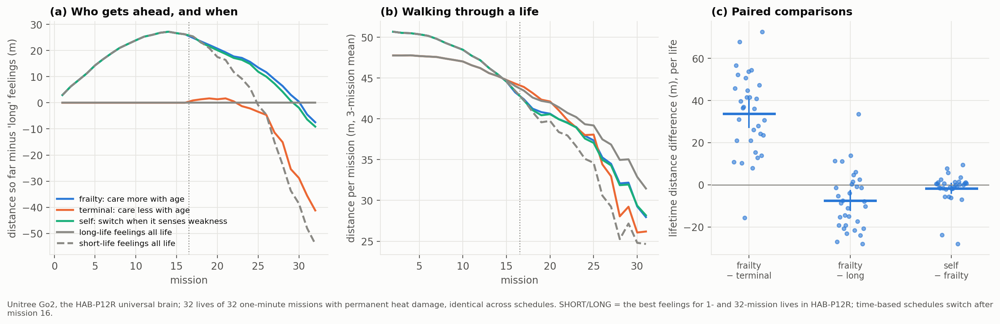

# HAB-P13 results: should a robot care more, or less, about its body as it ages? ("v13")

*Run 2026-11-11 (24 min: 5 schedules × 32 identical lives of 32 one-minute missions, the HAB-P12R
universal brain). Pre-registration: [`docs/prereg/HABP13_feelings_across_life.md`](../prereg/HABP13_feelings_across_life.md),
committed with the analyzer before any data. Data: [`data/habp13_go2/`](../../data/habp13_go2/).
Verdict: `python scripts/analyze_go2_v13.py --dir data/habp13_go2`.*

## Verdict: FRAILTY, but rewriting feelings with age does not beat caring all life

| | Result |
|---|---|
| **Gate:** do the two feelings change behaviour? | yes: first-mission wear 16.7k (SHORT) vs 14.1k (LONG), paired p = 9×10⁻²¹ |
| **P1:** frailty (care more with age) vs terminal (care less with age) | **frailty +33.8 m** [+26.9, +40.6], p = 3×10⁻¹¹, **31 of 32 lives** |
| **P2:** frailty vs long-life feelings all life | **−7.5 m** [−12.5, −2.4], p = 0.005: caring all life is **better** than switching |
| S1: robot that switches when it *senses* its own weakness vs frailty | −1.7 m [−4.3, +1.0], p = 0.21: equivalent |
| S2: when 'self' switched | mission 19 (median; range 16–21) |
| S4: long-life vs short-life feelings all life | long **+54 m**, p = 3×10⁻⁹ (consistent with HAB-P12R) |

Lifetime distance (32 missions): long 1357 m, frailty 1350, self 1348, terminal 1316, short 1303.

**Predictions written in advance:**
- Gate ✓.
- Frailty beats terminal (55%) ✓.
- Frailty beats long (30%) ✗: long won.
- Self ≈ frailty (70%) ✓.
- Long beats short (85%) ✓.

## What it means

**Caring less about the body in old age is the worst choice, in 31 of 32 lives.** The robot analogue of
*terminal investment* fails here:
- Robots that switch to carefree feelings for the second half of life walk 41 m less than robots that
  keep caring. Most of that loss comes in the last ten missions.
- They also fall more often (0.16 falls per life vs 0.06).

**Distance by half of life explains it:**

| | missions 1–16 | missions 17–32 |
|---|---|---|
| short-life feelings first (frailty, short, self) | 775 m | 528–575 m |
| long-life feelings first (long, terminal) | 749 m | 568–609 m |

- Being carefree early buys **+26 m**.
- But it costs **34 m** later, even when care resumes (frailty 575 vs long 609 m).
- So the early sprint is not free: it wears the body in ways that matter later.
- This corrects an exploratory reading in HAB-P12R. Feelings do not only help a robot *live with* an
  aged body. Caring early also *preserves* something that pays later.
- **Both mechanisms are at work:** early care (preservation) and late care (coping). Dropping either
  costs distance; dropping late care costs the most.

**A robot that notices its own weakness does as well as one that knows its age.** The 'self' robot
reads only its own motor strength and switches to long-life feelings when it falls below 0.6. That
happened at mission 19 on average, and the result matched the age-based schedule (p = 0.21).

**What wins, then, is constancy.** For a 32-mission life, the best feelings are the long-life ones
from start to finish. Within this design, rewriting feelings with age never beats feeling the right
thing all life. It only ranks the ways of being wrong: late carelessness is much worse than early
carelessness.

## Limits

- Two fixed feelings, chosen from HAB-P12R; one switching point.
- One brain; simulation with time-compressed thermal constants.
- A finer schedule (gradual change, other thresholds) could do better than "long all life". That is
  not tested here.
- "Feelings" means a reward function.

## Deviations

None in the analysis. The figure's 3-mission smoothing was changed after the first rendering to remove
edge artefacts at missions 1 and 32 (cosmetic).
