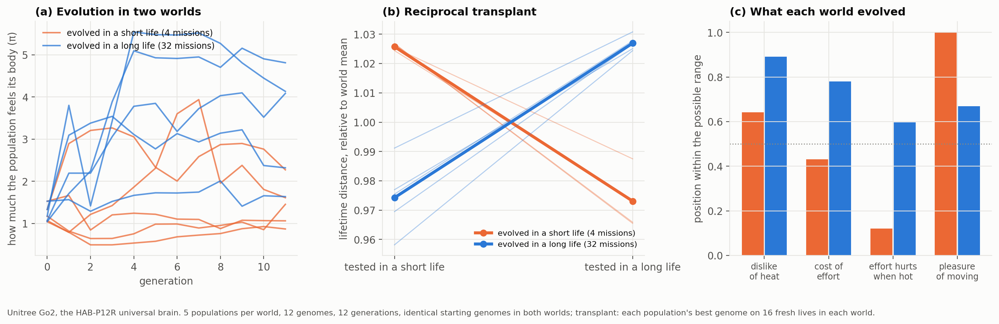

# HAB-P14 results: the evolution of feeling, with a reciprocal transplant ("v14")

*Run 2026-11-12 (179 min: 2 worlds × 5 populations × 12 genomes × 12 generations, then 320 transplant
lives; the last generation and the transplant ran on battery, which slowed them but does not affect
results). Pre-registration: [`docs/prereg/HABP14_evolution_of_feeling.md`](../prereg/HABP14_evolution_of_feeling.md),
committed with the analyzer before any data. Data: [`data/habp14_go2/`](../../data/habp14_go2/).
Verdict: `python scripts/analyze_go2_v14.py --dir data/habp14_go2`.*

## Verdict: PASS (local adaptation)

| Endpoint (exact permutation test, 5 vs 5 runs, Holm over 3) | Result |
|---|---|
| **P1:** evolved protectiveness, long world > short world | long 4.81, 2.32, 4.09, 1.64, 4.13 vs short 0.87, 2.27, 1.61, 1.06, 1.45; p = 0.016 (Holm 0.024), **significant** |
| **P2a:** on long lives, long-evolved > short-evolved | **1349 vs 1278 m (+5.5%)**, every long-evolved population above every short-evolved one; p = 0.008 (Holm 0.024), **significant** |
| **P2b:** on short lives, short-evolved > long-evolved | **204.0 vs 193.8 m (+5.3%)**, complete separation again; p = 0.008 (Holm 0.024), **significant** |

The reaction norms cross (panel b). Each evolved population is above average at home and below average
away.

**Predictions written in advance:** P1 75% ✓; P2a 70% ✓; P2b 55% ✓; overall PASS 40% ✓.

## What evolution designed (S1, median genes of the final populations)

| Gene | short world | long world |
|---|---|---|
| dislike of motor heat | 0.16 | **0.35** |
| comfort temperature | 0.61 | **0.53** (minds heat earlier) |
| cost of effort | 0.024 | **0.089** |
| effort hurts more when hot | 0.008 | **0.057** |
| pleasure of moving | **0.30** (the top of the allowed range) | 0.10 |

Starting from identical random genomes:
- **The short-life populations evolved robots that enjoy moving and barely mind their bodies.**
- **The long-life populations evolved robots that mind heat and effort and enjoy moving much less.**

This is the same pattern as the HAB-P12R landscape, now found by selection itself. Divergence in
protectiveness was visible within 3–4 generations (panel a).

## What it means

Taken together with HAB-P12R and HAB-P13:

1. Feelings about one's own body pay only when life is long (HAB-P12R, replicated).
2. Over a long life, the best policy is to keep caring, and above all not to stop in old age (HAB-P13).
3. **Selection discovers this on its own.** Two populations that differ only in how long their members
   live evolve opposite feelings, and each set of feelings is best in its own world (HAB-P14).

This is the robot counterpart of a classic result in the evolution of aging (Williams 1957; Kirkwood
1977; Austad 1993): how long an organism can expect to live shapes how much it invests in its body. In
these robots, that investment takes the form of what they feel.

## Limits

- **Only the feelings evolved.** The brain was the fixed universal brain of HAB-P12R; a brain that
  also learns or evolves could change the outcome.
- **Genes were clipped to the brain's training prior.** The short world pushed *pleasure of moving* to
  that ceiling (0.3), so its true optimum may lie beyond what this brain can represent.
- **P1 is the least clean** of the three: one long-world population (π 1.64) ended below one
  short-world population (2.27).
- **5 populations per world, 12 generations, one life per evaluation:** small populations and noisy
  fitness.
- Simulation with time-compressed thermal constants; "feelings" means a reward function.

## Deviations

None.
