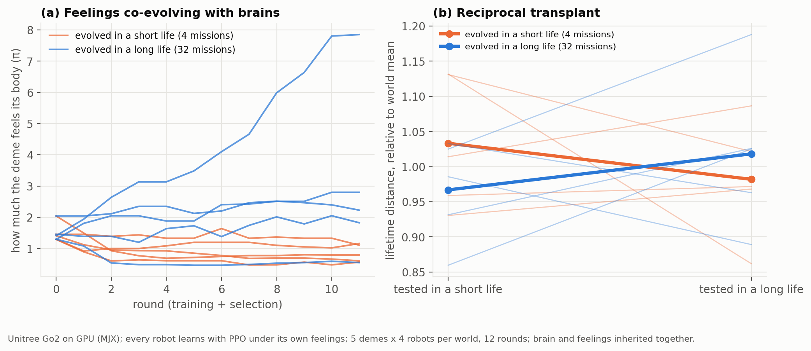
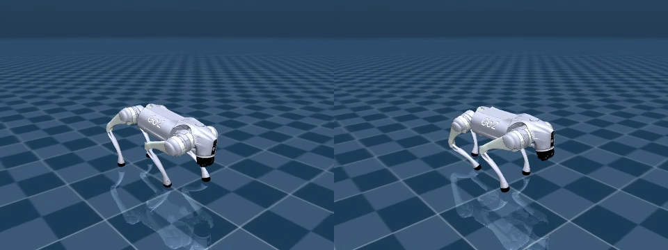

# HAB-P15 results: brain and feelings co-evolving in short vs long lives ("v15")

*Run 2026-11-13 on Kaggle 2×T4 (all 12 rounds completed; 40 robots, 12M PPO steps each). Pre-registration:
[`docs/prereg/HABP15_coevolution.md`](../prereg/HABP15_coevolution.md), committed with the code and
analyzer before the run. Data: [`data/habp15_gpu/`](../../data/habp15_gpu/) (the 38 MB trained-population
file is kept out of git). Verdict: `python scripts/analyze_go2_v15.py --dir data/habp15_gpu`. Kaggle's
output and a local re-run of the analyzer give identical numbers.*

*Best robot of the short world (left, [video](../media/habp15_short_world_best.mp4)) and of the long world
(right, [video](../media/habp15_long_world_best.mp4)), carrying 3 kg. Both learned to walk on the GPU.*

## Verdict: FAIL (valid run)

| | Result |
|---|---|
| **Gate:** learned to walk | yes: median 200 m in the first 4 missions (needed ≥ 100) |
| **P1:** protectiveness, long > short (per deme) | long 2.80, 2.23, 7.85, 0.55, 1.82 vs short 0.56, 0.79, 0.60, 1.16, 1.11. **4 of 5 demes in the predicted direction**; exact p = 0.048, **Holm 0.14, n.s.** |
| **P2a:** long lives, long-evolved > short-evolved | 1167 vs 1125 m; p = 0.59, n.s. |
| **P2b:** short lives, short-evolved > long-evolved | 205 vs 192 m; p = 0.25, n.s. |
| S2: protectiveness by round (medians) | short 1.54 → 0.79; long 1.54 → 2.28. The two worlds diverge steadily from identical starts |
| S1: final genes (medians) | the long world evolved far more **dislike of heat** (0.35 vs 0.02) |

**Predictions written in advance:** FAIL 45% (the most likely outcome) ✓. P1 55% ✗ (right direction,
not significant). P2a 55% ✗. P2b 40% ✗.

## What it means

- **The feelings still diverged the predicted way when brains co-evolved.** In 4 of 5 demes the
  long-life world evolved robots that mind their bodies more, and the population medians separated
  monotonically over the rounds. The average reaction norms in the transplant cross the predicted way
  (panel b). None of this reached significance under the pre-registered tests.
- **Why not (exploratory):**
  - Individual brains differ enormously: on the same long lives they walked anywhere from 700 to 1,490 m.
    That spread is several times the ~5% effect of feelings seen with a fixed brain (HAB-P14).
  - With 5 demes of 4 robots, 12 generations and one replacement per deme per round, selection on
    feelings is diluted by brain quality. This is the risk the pre-registration named (seen before in
    HAB-P10).
  - The clearest case: the long-world deme with the *least* protective feelings (π 0.55) had the *best*
    long-life performance (1,361 m), because its brains were simply better.
- **Overall:** the lifespan effect on feelings is robust when the brain is fixed (HAB-P12R, HAB-P14).
  With co-evolving brains at this scale it appears in direction but is not shown. Settling it would
  need more demes or longer evolution, i.e. more GPU time than one Kaggle session.

## Limits

- 5 demes × 4 robots per world; 12 generations; 12M PPO steps per robot.
- One Kaggle run (no replication).
- Simulation with time-compressed thermal constants.
- "Feelings" means a reward function.

## Deviations

None. All 12 rounds completed within the time limit, so the early-stop rule did not trigger.
