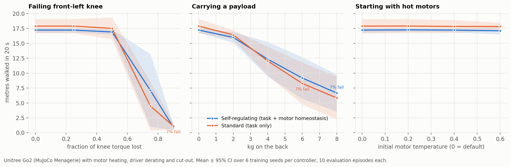

# HAB-P1 results — does a Unitree Go2 that manages its own motor heat keep walking under damage?

*Run 2026-11-08 (87 min, 12 PPO agents × 4M steps + 168 evaluation conditions). Pre-registration:
[`docs/prereg/HABP1_go2.md`](../prereg/HABP1_go2.md), pushed before any self-regulating agent
was trained. Data: `results/habp1_go2/go2_damage.csv`. Verdict: `python scripts/analyze_go2.py`.*

## Verdict: FAIL, and the treatment was too weak to test the hypothesis

| P1: metres walked under damage (AUDC) | self-regulating | standard | Δ [95% CI] | g | p | p (Holm) |
|---|---|---|---|---|---|---|
| failing front-left knee | 12.1 | 11.7 | +0.4 [−1.4, +2.2] | +0.22 | 0.68 | 1.00 |
| payload (2–8 kg) | 11.0 | 10.5 | +0.5 [−2.1, +3.0] | +0.18 | 0.75 | 1.00 |
| hot motors at start | 17.2 | 17.9 | −0.7 [−1.3, +0.2] | −0.84 | 0.16 | 0.49 |

- **P2 (no free lunch):** undamaged 17.2 vs 17.9 m, p = 0.22: no significant baseline cost.
- **M1 (does heat bite?):** undamaged peak motor temperature 0.82, above the 0.7 derating onset.
- **S1 (falls):** rare for both (≤ 7% at any level), no difference.
- **S3 (cost of transport):** 1.83 vs 1.77, p = 0.55.

## Why it failed (diagnosis after the fact, labelled as such)

1. **The treatment was nearly null.** Along both controllers' trajectories, the weighted
   homeostatic term was only about **1.5% of the task reward**. Its drive-reduction part also
   telescopes over an episode, which makes it close to a pure shaping term. The two controllers
   learned near-identical motor usage: mean temperature per motor differs by at most ~0.1, and
   peak temperatures are the same (0.83 vs 0.82). So the experiment compared two almost
   identical policies. This is a design error. The pre-registration should have required a
   *treatment-strength* check (the homeostatic term must be a substantial fraction of the
   reward) before running.
2. **Heat never caused a failure.** No motor reached cut-out in any of the 168 conditions
   (peak 0.82–0.87 against a cut-out at 1.0). The standard locomotion reward already penalises
   torque, which keeps motors out of trouble. Damage hurt the robot **mechanically**: with
   75–90% of a knee's torque gone it simply cannot walk (≈ 1–7 m). There was no thermal failure
   for self-regulation to prevent.
3. **Hot starts barely matter.** Starting at 0.6 sits below derating, and the motors settle
   back to their walking temperature within a few seconds.

## About the video

[`docs/media/go2_fault_side_by_side.mp4`](../media/go2_fault_side_by_side.mp4) shows the
scenario fixed in advance (75% knee fault, seed 0 of each controller, episode seed 20000). In
that episode the self-regulating robot walks 14.6 m and the standard one 1.6 m. **That is
not evidence of an effect.** Over all 6 seeds at this level the means are 7.1 vs 4.5 m, the
pre-registered test across levels is p = 0.68, and both robots reach the same peak motor
temperature. The contrast comes from two differently trained gaits coping with a weak knee,
not from heat management.

## What the next version needs (not yet run, not yet pre-registered)

- A treatment-strength gate, fixed before training: the homeostatic term must account for a
  stated minimum share of reward variance, or the run is void.
- A non-telescoping homeostatic cost (e.g. per-step cost of excess temperature) at a weight that
  actually changes motor usage, checked on the undamaged baseline only.
- Damage that can produce **thermal** failure, such as long missions (minutes, not 20 s) or a
  hotter ambient, so self-regulation has something to prevent. Mechanical damage alone tests
  gait robustness, not self-maintenance.

## Deviations from the pre-registration

- After the pre-registration was pushed (21:57), the pilot extrinsic model was run once in the
  75% knee-fault scenario to test the video pipeline (1.3 m, no fall). The design was already
  frozen and nothing was changed.
- No other deviations. All seeds are reported.
