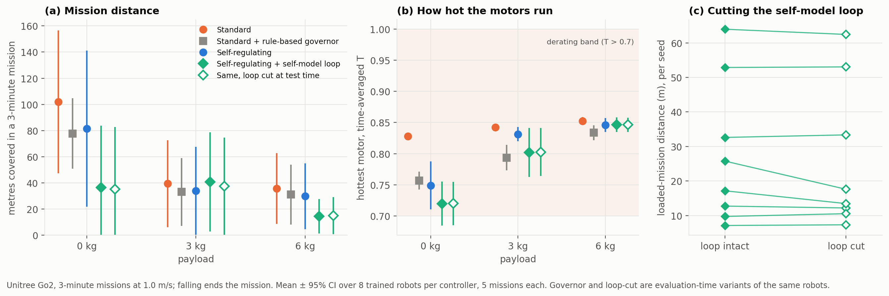

# HAB-P2 results — Go2 3-minute loaded missions, with a self-model in the loop

*Run 2026-11-09 (146 min: 24 PPO agents × 5M steps + 120 mission cells). Pre-registration:
[`docs/prereg/HABP2_go2_missions.md`](../prereg/HABP2_go2_missions.md), pushed at 00:04
before any mission ran. Data: [`data/habp2_go2/`](../../data/habp2_go2/). Verdict:
`python scripts/analyze_go2_v2.py`.*

## Verdict: FAIL, and this time the test was valid

| Endpoint | Result |
|---|---|
| **G0** treatment gate (unloaded missions: is the self-regulating robot ≥ 0.05 cooler?) | **passed**: hottest motor 0.749 vs 0.828 (0.079 cooler). The treatment really changed behaviour, unlike HAB-P1. |
| **P1** loaded-mission distance (3 & 6 kg), self-regulating vs standard | 31.9 vs 37.6 m, Δ −5.7 [−28.2, +15.6], g = −0.22, p = 0.64 → **not better** |
| **P2** unloaded-mission distance | 81.6 vs 101.9 m, p = 0.56 → no significant cost |
| S1 self-regulating vs rule-based governor | 31.9 vs 32.1 m, p = 0.99 (Holm 1.0) |
| S2 self-model vs self-regulating | 27.7 vs 31.9 m, p = 0.70 (Holm 1.0) |
| S3 **strange-loop test**: self-model intact vs cut, paired by seed | 27.7 vs 26.2 m, p = 0.21 (Holm 0.63). **No evidence the robot uses its self-model.** |

Only 2 of 600 missions ended in a fall (both self-regulating, 6 kg, one seed), and no motor
ever cut out (cut-out time 0.0% everywhere).

## What actually happened (exploratory, post-hoc: the verdict is unchanged)

The pre-registered metric, net displacement from the start, turned out to measure **heading
drift** as much as locomotion. Over 3 minutes every controller curves (net / path = 0.2–0.7).
Re-running the identical missions while recording the path walked
(`scripts/explore_go2_v2.py`, `data/habp2_go2/exploratory_missions.json`):

| | path walked (m) | | | hottest motor (time-avg.) | | | missions frozen > 50% of the time | |
|---|---|---|---|---|---|---|---|---|
| payload | 0 kg | 3 kg | 6 kg | 0 kg | 3 kg | 6 kg | 3 kg | 6 kg |
| standard | 156 | 114 | 65 | 0.83 | 0.84 | 0.85 | 0/40 | 5/40 |
| governor | 105 | 82 | 57 | 0.76 | 0.79 | 0.83 | 0/40 | 0/40 |
| self-regulating | 156 | 91 | 55 | 0.75 | 0.83 | 0.85 | **10/40** | **10/40** |
| self-model | 162 | 116 | 66 | 0.72 | 0.80 | 0.85 | 5/40 | 10/40 |
| self-model, loop cut | 161 | 116 | 66 | 0.72 | 0.80 | 0.85 | 5/40 | 10/40 |

Three lessons:

1. **Unloaded, self-regulation is free cooling.** Same path walked (156 vs 156 m) with the hottest
   motor 0.08 cooler on average (0.11 with the self-model). On hardware, lower winding temperature
   means more thermal headroom and slower insulation ageing. That is real, but modest.
2. **Under load the drive backfires: the robot freezes instead of pacing itself.** In a quarter
   of loaded missions the self-regulating robot stops walking. That is the short-sighted way to cut
   heat, and it doesn't even work, because standing with a payload keeps the knees hot (0.83–0.85).
   Trained on 20-s episodes with γ = 0.99 (≈ 2-s horizon), the policy cannot plan over minutes.
   Pacing a 3-minute mission is a long-horizon skill it was never trained on.
3. **The self-model was learned but not used.** It predicts its own motor temperatures 2 s ahead
   well (loss ≈ 3×10⁻⁵), yet cutting it out of the loop changes nothing (identical rows above).
   Exposing a self-prediction as one more input is not enough. For the loop to matter, the
   prediction must sit inside the decision: a cost on *predicted* overheating (anticipatory /
   allostatic regulation), or planning with the model.

## What would actually test the idea next (not run, not pre-registered)

- Train on mission-length episodes (or γ ≈ 0.999) so pacing over minutes is learnable at all.
- Put the self-model in the decision pathway: reward or constrain on predicted temperature
  2–10 s ahead, and keep the cut-the-loop test.
- Pre-register path length (with a heading command) instead of net displacement.
- Keep the treatment gate (it worked) and add a **freeze gate**: a controller that stops walking
  in loaded missions fails the competence check, whatever its temperature.

## Deviations from the pre-registration

- Disclosed in the pre-registration itself: the treatment calibration rule could not be met in
  20-s pilots; c = 0.2 was chosen and the cooling requirement moved to the mission gate G0 (which passed).
- All exploratory analyses above were added after seeing the results and are labelled as such.
- No other deviations. All 24 agents are reported.
