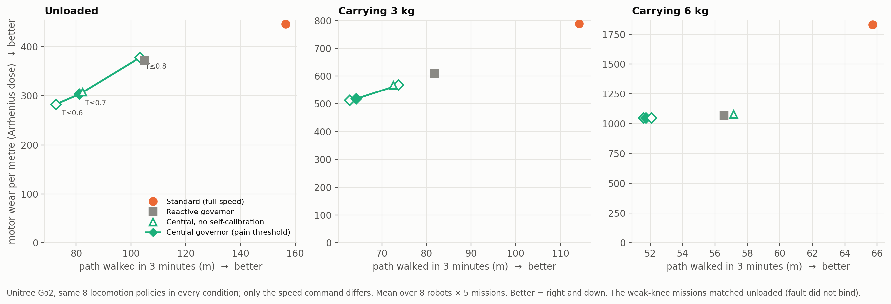

# HAB-P7 results — a nature-inspired homeostatic control stack on the Unitree Go2 ("v7")

*Run 2026-11-09 (10 min: 8 development walks + 960 three-minute missions). Pre-registration:
[`docs/prereg/HABP7_central_governor.md`](../prereg/HABP7_central_governor.md), pushed before any
evaluation mission. Data: [`data/habp7_go2/`](../../data/habp7_go2/). Verdict:
`python scripts/analyze_go2_v7.py`.*

## Verdict: FAIL, as predicted (P(pass) was put at ~35% before running)

| Endpoint | Result |
|---|---|
| **P1** motor wear per metre, central governor / full speed | **0.67×** (−33%), p = 0.0003 → **supported** |
| **P2** competence guard: path walked, central / full speed (need 95% CI lower bound ≥ 0.85) | 0.78, CI [0.33, 1.24] → **fails** |
| S1 central vs reactive governor | wear/m 0.86× (Holm p = 7×10⁻⁵), but path 0.81 [0.78, 0.85] → not supported |
| S2 online self-calibration vs none (3 kg, 6 kg, weak knee) | wear/m 0.95× (Holm p = 0.049) → **supported** |
| S3 central at threshold 0.8 vs full speed | wear/m 0.77× (Holm p = 0.011), path 0.87 [0.43, 1.31] → not supported |

Per robot, the governor walked 51–71% as far as full speed for 7 of 8 robots, and **2.1× as far**
for one: its full-speed version froze under the 6 kg load, the paced version didn't.

## What worked

- **The robots learned their own physics.** From a 135-s exploratory walk, using only 1 °C-quantised
  motor temperatures and motor torques, every robot recovered its heating gain (0.562–0.571; true
  0.57) and cooling time constant (9.98–10.15 s; true 10.0), all within 1.5%.
- **Self-knowledge of the *current* body helps** (S2): online re-calibration detects a payload and
  reduces wear under load.
- **Any thermal governor helps a lot under heavy load.** At 6 kg, wear per metre falls from 1833
  (full speed) to ~1050 (−43%), and time spent frozen falls from 18% to 6–8%.

## What did not, and why (exploratory diagnostics, verdict unchanged)

1. **The anticipatory governor sits on the same trade-off curve as simple reactive throttling.** At
   matched distance it is no better (unloaded the reactive rule is ~3% better; at 3 kg they coincide;
   at 6 kg reactive walks slightly further for the same wear). In steady 3-minute missions with a
   10-s thermal time constant the body reaches steady state within ~30 s, so "planning to the end"
   collapses into "pick a slower steady pace". Anticipation should only pay when future demands
   differ from present ones (hills, a sprint later, rest stops). That is the same lesson as the
   evolution experiment, where regulation strategies matter when conditions change.
2. **Pacing is a weak lever because most heat comes from bearing weight.** At 0.4 m/s the hottest
   motor still receives **55%** (43–66%) of the heat it receives at 1.0 m/s. The hottest motors are
   the rear thighs in 7 of 8 robots. Slowing by 60% cools the hottest motor only from ≈ 0.9 to ≈ 0.7.
3. **The only Pareto improvement in the whole project came from the gait, not the pace.** HAB-P2's
   self-regulating policy walks the same unloaded distance with **13% less total heat input** at
   nearly the same 20-s speed (16.2 vs 16.7 m). It does not stand taller (knee angle and trunk height are
   identical); the change is in subtler gait details. So *how* the robot moves matters more than
   *how fast*. (A posture explanation we proposed, a passive "stay apparatus" as in horses, is **not**
   supported by these measurements.)

## What this implies for the next version (not run, not pre-registered)

Combine the two levers at their own timescales, as nervous systems do: a heat-aware **gait** (the
RL level, which found the only Pareto gain) under a **pacing** governor that prevents freezing,
tested on missions whose **demands change over time** (load picked up mid-mission, climbs), where
anticipation can actually matter, with a **matched-distance** primary comparison against reactive
throttling rather than against full speed.

## Deviations from the pre-registration

- A bug in the governor's online calibration (seeding its estimate from an empty first reading)
  was found by a unit test and fixed **before** the pre-registration commit; no evaluation mission
  ran with the old code.
- The weak-knee missions turned out identical to unloaded missions in every condition. A 50%
  torque cut on the front-left knee never binds for these gaits. This is reported, not removed.
- All diagnostics above (per-robot ratios, weight-bearing fraction, posture comparison, matched-distance
  reading of the trade-off curve) were added after seeing results and are exploratory.
