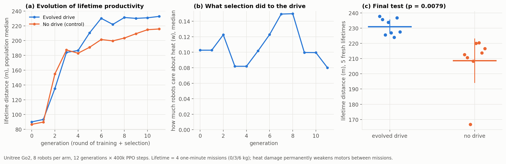

# HAB-P9 results — evolution chooses the drive ("v9")

*Run 2026-11-09 (run 2, 146 min on the laptop: 16 Go2 robots × 12 generations × 400k PPO steps, then
80 fresh lifetimes). Pre-registration: [`docs/prereg/HABP9_evolved_drives.md`](../prereg/HABP9_evolved_drives.md),
including Amendment 1 (run 1 was void: a seeding bug made copied robots exact clones). Data:
[`data/habp9_go2/`](../../data/habp9_go2/). Verdict: `python scripts/analyze_go2_v9.py`.*

## Verdict: PASS, the first pre-registered PASS in the robot line

| Endpoint | Result |
|---|---|
| **P1** lifetime distance (4 one-minute missions, permanent motor aging), evolved-drive vs no-drive robots | **231.0 vs 208.6 m (+11%)**, Welch p = **0.0079** → **PASS** |
| Separation | **complete**: the worst evolved robot (224.0 m) beat the best control robot (220.4 m) |
| **S1** did selection keep a body drive? | **yes, a moderate one**: final drive strengths 0.036–0.40, median 0.08 (none driven to zero) |
| **S2** were bodies better preserved? | **no**: motor strength after a lifetime 0.857 vs 0.861 (p = 0.44); total wear 63k vs 61k |
| **S3** falls / freezing | evolved 0.00 falls per lifetime, 0% frozen; control 0.15 falls per lifetime, 1% frozen |

The control arm is valid this time: its robots stayed distinct throughout (e.g. 8/8 different scores
in generation 3; the two closest in the last generation, 223.71 and 223.69, are different robots with
different final-test lifetimes).

## What it means, and what it doesn't

- **Supported:** when evolution is allowed to give robots a drive about their own motor heat,
  inherited and mutated across generations, the resulting robots are **more productive over a
  lifetime** than equally trained and equally selected robots without one, and they never fell.
  Selection **kept** the drive at a moderate strength rather than discarding it.
- **Not supported:** the mechanism we predicted. The evolved robots did **not** preserve their
  motors better (strength and wear are the same). Their advantage came from walking further and more
  reliably, not from wearing their bodies less.
- **Two explanations remain, and this design cannot separate them:**
  1. A moderate heat drive is a better *training signal*: it shapes gaits that are more efficient and
     more stable under changing loads (consistent with HAB-P8, where the heat-aware gait was the only
     Pareto gain).
  2. **Diversity of objectives**: in the evolved arm each robot trains on a slightly different reward,
     which keeps the population more diverse, and population-based training benefits from diversity.
     The control arm can only differ by random seed.
- **Next experiment to separate them:** a third arm with *random but fixed* drive strengths
  (diversity without inheritance), and a replication at larger scale on GPU.

## Limits
8 robots per arm; one laptop; thermal and aging constants time-compressed and not identified on
hardware; a single environment family. No claim about experience or consciousness.

## Deviations
- Run 1 void (seeding bug), documented in Amendment 1 before run 2; run 2 used the frozen design unchanged.
- The figure's drive panel uses a linear axis (cosmetic, changed after the run).
