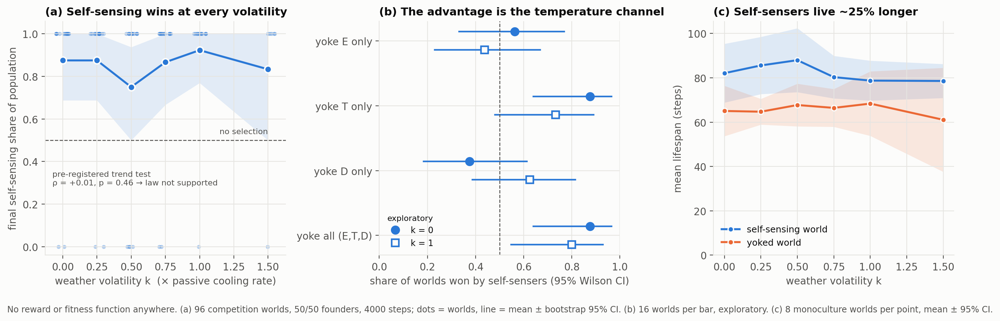

# HAB-E2v results — does environmental volatility select for self-regulation?

*Run 2026-11-08. Pre-registration: [`docs/prereg/HAB_E2v_regulator_law.md`](../prereg/HAB_E2v_regulator_law.md)
(committed before the first weather-enabled run). Raw data: `results/regulator_law/runs.json`,
verdict: `results/regulator_law/verdict.json`. Reproduce: `python scripts/run_regulator_law.py`
(~17 min on 2 cores), then `python scripts/run_channel_dissection.py` (~4 min).*

## Verdict

**The pre-registered hypothesis failed.** Selection for self-sensing does **not** increase with
environmental volatility in this world: Spearman ρ = **+0.01**, one-sided p = **0.46** (82
competition worlds; 14 went extinct and are excluded from this endpoint, as pre-registered).
The K-regime replication also fails (ρ = +0.31, p = 0.19). Under the anti-rigging rule we stop
here: no further weather variants will be tried in search of a pass.

The same run **reverses the July 2026 conclusion** of HAB-E2 ("pure selection does not build
self-regulation"). That conclusion came from a confounded design. With a fair control, selection
strongly favours organisms that sense their own body.

## Pre-registered endpoints

| Endpoint | Result |
|---|---|
| **P1** Spearman(k, final self-sensing share) | ρ = +0.01, p = 0.46 → **not supported** |
| **P1b** at k = 0, is the share ≠ 0.5? | median **1.00**, Wilcoxon p = **0.003** → self-sensing is strongly selected *even in a constant world* |
| **S1** conformer slope (T vs. weather) | self-sensing ≈ yoked at every k (e.g. k = 1.5: +0.20 vs +0.21) → **no weather-buffering signature** |
| **S2** clamp-probe thermal reflex | evolved slope drifts from +0.05 (k = 0) to ≈ 0 (k = 1.5), ρ = −0.40, p = 0.0006. It never becomes a "slow down when hot" reflex. |
| **S3** monoculture population / extinction | indistinguishable at k ≤ 0.75 (all at the 500 cap); k = 1.5: 422 vs 350, MWU p = 0.80; extinctions 6/8 vs 5/8 |
| **S4** K-regime replication of P1 | ρ = +0.31, p = 0.19 → does not replicate |

Final self-sensing share per volatility level (16 worlds each, bootstrap 95% CI):

| k | 0 | 0.25 | 0.5 | 0.75 | 1.0 | 1.5 |
|---|---|---|---|---|---|---|
| mean share | 0.88 | 0.88 | 0.75 | 0.87 | 0.92 | 0.83 |
| 95% CI | 0.69–1.00 | 0.69–1.00 | 0.50–0.94 | 0.67–1.00 | 0.77–1.00 | 0.50–1.00 |
| extinct worlds | 0 | 0 | 0 | 1 | 3 | 10 |

Pooled over all levels, self-sensers took over **70 of 82** surviving worlds (binomial
p = 4×10⁻¹¹). Every world ended at fixation: 70 fully self-sensing, 12 fully yoked.

## Exploratory analyses (not pre-registered — treat as hypotheses)

1. **Self-sensers live 25% longer.** Monoculture mean lifespan 82.2 vs 65.6 steps (48 vs 48
   worlds, Mann–Whitney p = 5×10⁻⁷), same direction at all six k. They also suffer fewer heat
   deaths (e.g. k = 0: 21.8k vs 25.0k).
2. **The advantage is carried by the temperature channel.** We yoked one interoceptive channel
   at a time (16 new worlds per cell, `scripts/run_channel_dissection.py`):

   | yoked channel | k = 0: worlds won by self-sensers | k = 1.0 |
   |---|---|---|
   | energy only | 9/16 (p = 0.80) | 7/16 |
   | **temperature only** | **14/16 (p = 0.004)** | 11/15 |
   | damage only | 6/16 (p = 0.45) | 10/16 |
   | all three | 14/16 (p = 0.004) | 12/15 |

   Losing only self-temperature reproduces the full effect. Losing self-energy or self-damage
   does nothing measurable.
3. **Kinesis probe** (clamped hot, cooling swept 0 → 1): null at every k. Evolved organisms
   don't simply stop when they find a cool zone.
4. **Selection speed.** The 2-seed smoke run suggested volatility speeds up selection about
   4×. At 16 seeds there is no trend (initial logit slope 0.44, 0.63, 0.49, 0.49, 0.30, 0.74).
   It was noise, and we report it only so the record is complete.

## Interpretation

- **What we can say:** in a reward-free evolutionary world, organisms that read their own
  temperature out-compete identical organisms reading someone else's, and they live longer.
  Selection discovers the value of self-information on its own. That holds in a constant
  world, so it doesn't need environmental volatility.
- **What we cannot say:** that this is *homeostasis* in the physiological sense. The
  pre-registered regulation signatures (weather buffering, a negative thermal reflex) are
  absent. Self-temperature is used by a mechanism our probes don't capture. Candidates for
  the next experiment: (a) T as a slow trace of the organism's *own* recent motor output
  (heat ∝ speed), effectively a proprioceptive or efference-copy signal; (b) a use that
  depends on context and only appears with the other inputs active; (c) an effect through
  the Oja plasticity dynamics rather than the instantaneous policy.
- **Why the regulator law failed here:** the constant world was never thermally constant from
  the organism's point of view. Its own running generates heat faster than passive cooling
  removes it (0.09 × 0.35 > 0.016). Self-temperature information is valuable from k = 0, so
  extra weather adds little on top.

## Correction of the July 2026 HAB-E2 claim

July's runs compared intact and blind populations **in separate worlds**, with "blind" meaning
**zeroed** E/T/D inputs. Two consequences:

1. Separate-world lifespans can't say which strategy selection prefers. Only competition can.
2. Zeroing three inputs that are normally about 0.3–0.6 also changes how strongly every hidden
   unit is driven. The "blind organisms are cooler and slower" effect is at least partly an
   input-scale artefact.

With the yoked control (same input statistics, no self-information) and head-to-head
competition, the sign flips: self-sensers win and live longer. The July conclusion is
retracted. The negative July data remain in the record (`docs/EMERGENCE.md`).

## Deviations from the pre-registration

None in the protocol. Additions made after seeing the 2-seed smoke run (kinesis probe,
selection-speed analysis) and after the main run (lifespan test, channel dissection) are
labelled exploratory above and in every output file.
